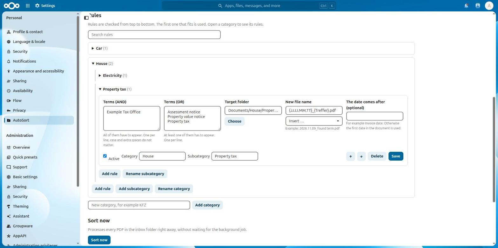

# AutoSort

A Nextcloud app that moves and renames PDFs from an inbox folder based on the text inside them.

Every user sets up their own rules in **Personal settings > AutoSort**. A rule says which words a document has to contain, which folder it belongs in and what the file should be called.



## Features

- Rules with **all of these words (AND)** and **at least one of these words (OR)**
- Categories and subcategories to keep many rules tidy, plus a search
- File names built from the date in the document, the original name or the first matching OR word
- Files with the same name are numbered (`name_1.pdf`, `name_2.pdf`) and never overwritten
- A test button that shows what would happen to a PDF without moving it
- A log per user with a link to each sorted PDF
- Optional: only sort once a tag is set, for example the tag an OCR workflow adds when it is done

## Requirements

- Nextcloud 33 to 36
- `pdftotext` on the server (`sudo apt install poppler-utils`)
- PDFs with a text layer. Scans need OCR first, for example with [Workflow OCR](https://apps.nextcloud.com/apps/workflow_ocr)

## Usage

1. Open **Personal settings > AutoSort** and save an inbox folder.
2. Add a rule with the words to look for, a target folder and a file name.
3. Check it with **Try it out**.
4. New PDFs in the inbox are sorted by the background job. **Sort now** processes the inbox right away.

Rules are checked from top to bottom and the first one that fits is used. Subfolders of the inbox are left alone. PDFs without text wait in the inbox.

### File name placeholders

| Placeholder | Meaning |
|---|---|
| `{JJJJ.MM.TT}`, `{JJJJ-MM-TT}`, `{TT.MM.JJJJ}`, `{JJJJMMTT}` | Date from the document (J = year, M = month, T = day) |
| `{JJJJ}`, `{MM}` | Year, month |
| `{Original}` | Original file name |
| `{Treffer}` | The first word of the OR list that occurs in the document |

The list next to the file name inserts them for you. A rule that needs a date and finds none does not apply, so no half-finished names are created.

### Example: one rule for many kinds of letters

With the OR list below and the file name `{JJJJ.MM.TT}_{Treffer}.pdf`, each letter gets a fitting name. The general word at the end catches everything else. Put specific words first.

```
Assessment notice
Property value notice
Property tax
```

## Development

The app has no build step: plain PHP and JavaScript. Copy or link this folder to `custom_apps/autosort` and enable it with `occ app:enable autosort`. The tests need no Nextcloud: `php tests/matcher.php`, `php tests/rules.php` and `php tests/extractor.php`.

## License

AGPL-3.0-or-later
